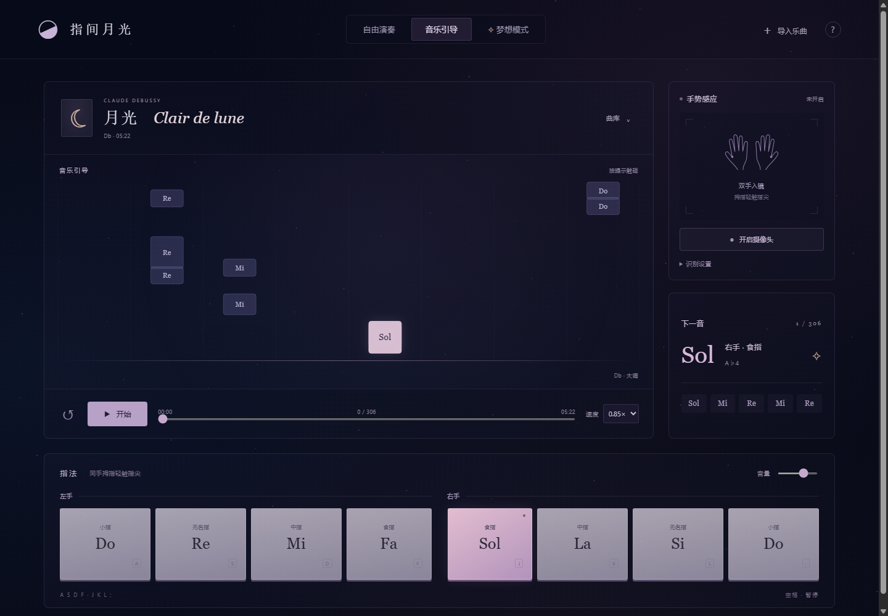
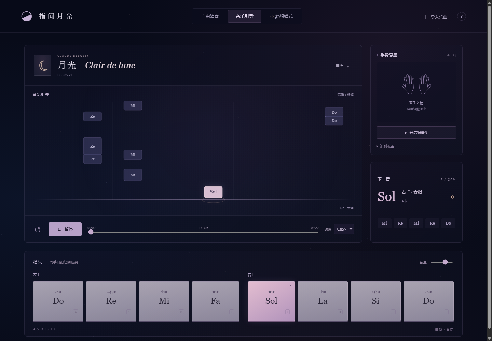
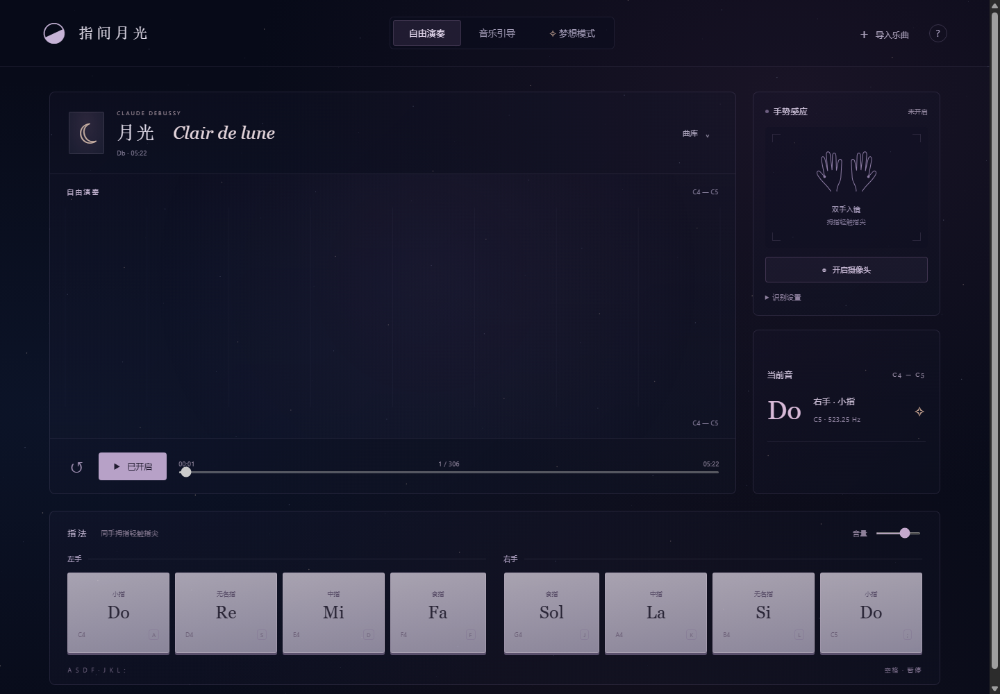
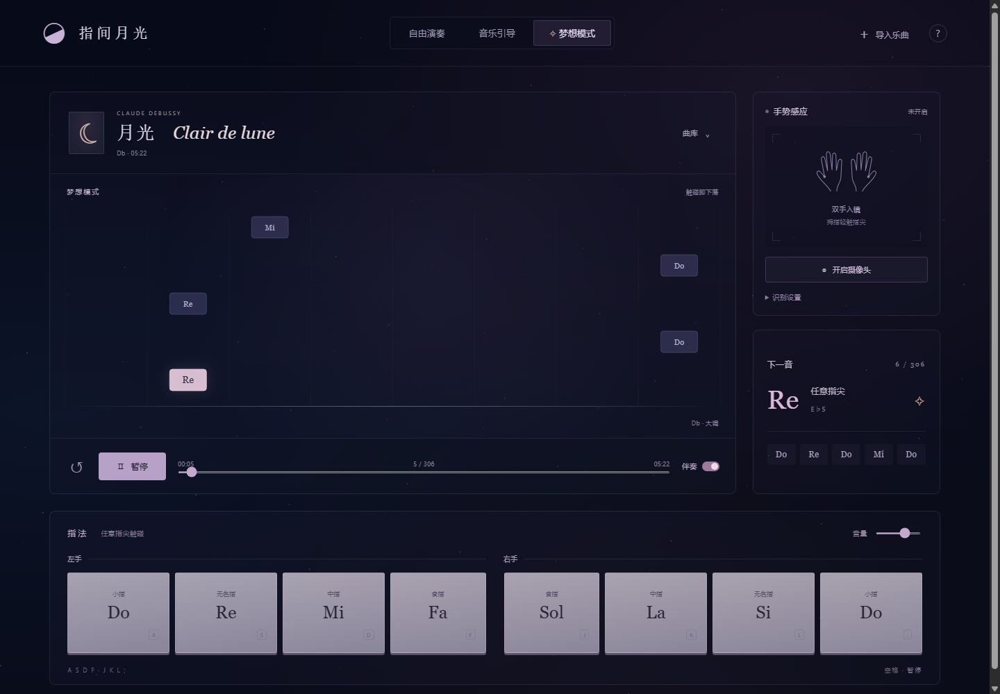
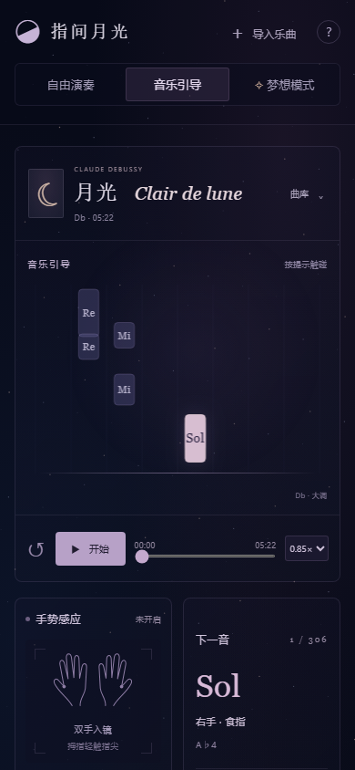

# 指间月光 · 手势钢琴

**第 5 版完整复刻 · Moon Fingers v5**

对一个开源手势钢琴网页第 5 版快照（`a22d8816fd7b017a05acefc00a6da9cbe8605dd6`）的完整、离线可运行复刻。页面结构、样式、逻辑、MediaPipe 手部模型与 WASM、28 个钢琴采样、内置《月光》MIDI 和 LilyPond 乐谱全部保持原样，**没有改写任何运行时文件**。

**在线地址（GitHub Pages）：** https://yinqian642.github.io/moon-fingers-piano/

**GitHub 仓库：** https://github.com/YinQian642/moon-fingers-piano



## 快速开始

只需要 Node.js（本复刻在 Node.js 24.22.0 上验证），不需要 `npm install`、不需要构建、不需要联网。

```bash
node verify-dist.mjs     # 校验 52 个运行时文件
node serve.mjs           # 启动本地服务器
```

然后在 Chrome 或 Edge 打开：

```
http://127.0.0.1:4192
```

Windows 也可以双击 `启动复刻网页.cmd`，并保持命令行窗口开启。

首次使用：点击「开始 / 开启声音」，等钢琴采样加载完成；再点击「开启摄像头」并授权。摄像头只在浏览器本机推理，画面不上传。摄像头要求 `localhost` / `127.0.0.1` 或 HTTPS，**不要**直接双击 `dist/index.html` 用 `file://` 打开。

> 端口 4192 被占用时，先结束旧的同名服务再启动。本目录的 `serve.mjs` 与原版一致，固定监听 `127.0.0.1:4192`。

## 发布为独立网站

这是纯静态站点，把 `dist/` 的全部内容原样上传即可。服务器需要：

- 使用 **HTTPS**（摄像头在非 localhost 环境要求安全上下文）；
- 正确返回 `.mjs` / `.js`（`text/javascript`）、`.wasm`（`application/wasm`）、`.task`、`.mp3`（`audio/mpeg`）、`.mid`（`audio/midi`）等类型；
- 保留 `assets/`、`vendor/`、`vendor/wasm/` 的相对目录结构，不要只上传 `index.html`；
- 允许 Web Worker 与 WebAssembly 正常加载。

不要复用原项目的托管身份或 `.openai/hosting.json`；本复刻未包含该配置，发布时应使用自己的站点。

当前在线版使用 GitHub Pages：`main` 分支保存完整源码，`gh-pages` 分支保存 `dist/` 的站点内容并附带 `.nojekyll`，Pages 从 `gh-pages` 根目录发布。修改 `dist/` 后重新生成并推送 `gh-pages` 即可更新线上页面：

```bash
git subtree split --prefix=dist -b gh-pages
git push origin gh-pages
```

更新后通常一到两分钟生效。

## 三个演奏模式

| 模式 | 行为 |
| --- | --- |
| 自由演奏 | 左手小指 → 无名指 → 中指 → 食指为 Do Re Mi Fa；右手食指 → 中指 → 无名指 → 小指为 Sol La Si 高 Do。固定 C4–C5，双手、多指可同时发声，保留钢琴采样和适度尾音。 |
| 音乐引导 | 按提示的指法触碰对应手指，乐曲按原谱继续；停手时等待。原谱决定实际音高与八度，不转调。 |
| 梦想模式 | 任意指尖触碰拇指，立即奏响下一枚旋律音并推进画面，节奏完全由触碰决定；同一次合击只推进一音。伴奏可单独开启，默认关闭。 |

屏幕琴键和 `A S D F / J K L ;` 与摄像头输入等价，空格暂停 / 继续，`↺` 从头开始。右侧「识别设置」可调触碰灵敏度（0.22–0.46，默认 0.34）和交换左右手标签；曲库支持导入 `.mid` / `.midi`、选择旋律音轨。

## 页面能力

- 深空蓝紫暖色主题、细小慢移星点背景、由输入驱动的下落音符与触碰涟漪。
- 三个模式共用八指输入、Salamander 钢琴采样、Web Audio 包络与同音重击处理。
- MediaPipe Hand Landmarker 在 Web Worker 内本地推理，GPU 不可用时回退 CPU；同一时刻只处理一帧，不堆积旧画面。
- 内置德彪西《月光》完整钢琴 MIDI：1,468 个音符、306 个手势提示、322.5 秒；保留原调与实际音高。
- 曲库、MIDI 导入、帮助弹窗、来源弹窗、进度拖动、速度选择、音量控制。
- 桌面、平板与手机布局（800px / 450px 断点），并遵循 `prefers-reduced-motion`。

## 项目结构

```
moon-fingers-replica/
├─ dist/                     # 完整静态网站（51 个文件，逐字节来自源快照）
│  ├─ index.html
│  ├─ style.css / cosmos.css
│  ├─ app.js
│  ├─ lib/                   # music / gestures / audio / visuals / hand worker
│  ├─ assets/                # 28 个钢琴 MP3、MIDI、LilyPond 乐谱
│  └─ vendor/                # MediaPipe 模型、WASM、midi.js 及第三方授权
├─ serve.mjs                 # 零依赖本地静态服务器（127.0.0.1:4192）
├─ verify-dist.mjs           # 运行时文件 SHA-256 校验
├─ MANIFEST.sha256.json      # 源快照逐文件校验清单
├─ SNAPSHOT.json             # 源快照版本元数据
├─ 启动复刻网页.cmd
├─ tools/verify-replica.mjs  # 无 npm 依赖的 CDP 端到端浏览器验证
├─ screenshots/              # 复刻实机截图与验证报告
├─ docs/                     # 原版 README 与源码交接说明
└─ README.md / VERIFICATION.md
```

## 完整性校验

```bash
node verify-dist.mjs
```

输出：

```
Verified 52 runtime files (dist/ + serve.mjs).
Source snapshot a22d8816fd7b017a05acefc00a6da9cbe8605dd6.
```

源包校验清单共 68 个文件；其中真正构成网页运行的 51 个 `dist/` 文件和 `serve.mjs` 全部纳入并逐字节校验。原包的开发测试、浏览器测试运行器、资源下载脚本和 `.openai/hosting.json` 托管身份配置不参与网页运行，因此未纳入本复刻；原始说明仍保存在 `docs/`。

## 验证结果

已在 Windows + Chrome 157.0.8103.51 上通过无头浏览器完整跑通：三种模式、8 个键盘音、MIDI 导入、曲库恢复、进度跳转、屏幕琴键、MediaPipe 模型加载与实时推理、28 个钢琴采样解码、移动端布局。**26 项检查全部通过**，没有页面异常、失败请求、4xx/5xx 或外部网络依赖。

详见 [VERIFICATION.md](VERIFICATION.md) 与 [screenshots/report.json](screenshots/report.json)。

| 音乐引导 | 自由演奏 |
| --- | --- |
|  |  |
| **梦想模式** | **移动端** |
|  |  |

## 已知限制

- 源快照第 5 版的手势识别尚未经过使用者真实摄像头复测。本复刻的自动化验证使用 Chrome 假摄像头，只证明模型能加载并以约 150 ms/帧推理，**不代表真实手指触碰的识别率**。
- 实际识别表现受摄像头、光照、遮挡、双手交叉、浏览器和系统字体影响；不同设备的音量、延迟与像素级外观可能不同。
- 音频验证覆盖采样解码、Web Audio 声部与触键事件；实际扬声器响度与听感取决于设备。
- 验证浏览器为 Chrome；Safari / Firefox 未做现场验证。
- MIDI 导入采用高声部旋律提取策略，复杂乐曲可通过切换音轨改善结果；不支持 MP3/WAV 自动转谱、踏板控制器、弯音或多乐器音色。

## 来源与授权

- 乐谱与 MIDI：[Mutopia Project #1778](https://www.mutopiaproject.org/cgibin/piece-info.cgi?id=1778)，Keith OHara 制谱，依据 E. Fromont（1905），Public Domain。原始 LilyPond 文件保留在 `dist/assets/clair-de-lune.ly`。
- 钢琴采样：[Salamander Grand Piano / Alexander Holm](https://github.com/Tonejs/audio/blob/master/salamander/README)，CC BY 3.0，使用 Tone.js 托管的 MP3 采样，授权文件在 `dist/assets/piano/LICENSE.txt`。
- 手部识别：Google MediaPipe Hand Landmarker，Apache 2.0，模型、WASM 与授权文件在 `dist/vendor/`。
- [@tonejs/midi](https://github.com/Tonejs/Midi) 2.0.28，MIT，浏览器解析器与授权文件在 `dist/vendor/`。
- 原网页快照与线上地址见 `SNAPSHOT.json`；原版技术说明与交接文档保存在 `docs/`。

本复刻仅重新打包与验证，页面运行时文件未做修改。若需二次发布，请保留上述第三方授权文件与来源标注。
