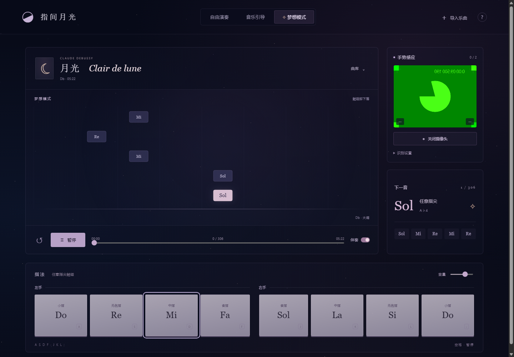

# 复刻验证报告

- 验证日期：2026-11-13（Asia/Shanghai）
- 复刻对象：指间月光 · 手势钢琴 第 5 版，源码快照 `a22d8816fd7b017a05acefc00a6da9cbe8605dd6`
- 验证方式：Windows + 无头 Chrome 通过 DevTools Protocol 驱动真实页面，无 npm 测试依赖
- 结果：**26 / 26 项通过**

## 环境

| 项目 | 值 |
| --- | --- |
| 操作系统 | Windows |
| Node.js | v24.22.0 |
| 浏览器 | Chrome 157.0.8103.51（headless=new） |
| 桌面视口 | 1440 × 1000 |
| 移动视口 | 390 × 844 |
| 服务器 | 本目录 `node serve.mjs`，`http://127.0.0.1:4192` |
| 摄像头 | Chrome 假摄像头（`--use-fake-device-for-media-stream`） |

## 运行时完整性

```bash
$ node verify-dist.mjs
Verified 52 runtime files (dist/ + serve.mjs).
Source snapshot a22d8816fd7b017a05acefc00a6da9cbe8605dd6.
```

52 个运行时文件（51 个 `dist/` 文件 + `serve.mjs`）的字节数与 SHA-256 均与源快照的 `MANIFEST.sha256.json` 一致。`dist/` 中包括：

- 页面与逻辑：`index.html`、`style.css`、`cosmos.css`、`app.js`、`lib/*.js`
- 手部识别：`vendor/hand_landmarker.task`（7.8 MB）、`vendor/vision_bundle.mjs`、两套 SIMD / 非 SIMD WASM（约 19 MB）
- 音色：28 个 Salamander 钢琴 MP3
- 乐曲：`assets/clair-de-lune.mid`（1,468 音符 / 322.5 秒）与 LilyPond 源文件
- 第三方解析器与授权：`vendor/midi.js`、各 LICENSE 文件

## 测试矩阵

### 曲谱与初始状态

| 检查 | 证据 | 结果 |
| --- | --- | --- |
| 内置《月光》暴露 306 个手势提示 | 306 cues | 通过 |
| 完整保留 1,468 个钢琴音符 | 1468 notes | 通过 |
| 初始为音乐引导模式、可开始 | guided / ready | 通过 |
| 第一音为原谱的 Sol / A♭4，时间 0.5 s | slot 4, midi 68, time 0.5 | 通过 |
| 曲名、计数、时长 UI 正确 | 月光 Clair de lune / 1 of 306 / 05:22 | 通过 |

### MIDI 导入与钢琴采样

| 检查 | 证据 | 结果 |
| --- | --- | --- |
| 导入 MIDI 可解析并弹出音轨选择 | 2 个音轨、1,468 音符 | 通过 |
| 28 个 Salamander 采样全部解码 | `audioReady = true` | 通过 |
| 28 个 MP3 都来自本地 `assets/piano` | 28 个本地请求 | 通过 |
| 引导模式按提示指法推进 | index 1, hits 1 | 通过 |
| 正确触碰产生真实钢琴 attack | 2 attacks | 通过 |

### 自由演奏

| 检查 | 证据 | 结果 |
| --- | --- | --- |
| 8 个键盘音各自独立触发一次 | 每指 +1 | 通过 |
| 自由模式不推进曲谱 Transport | mode = free | 通过 |
| 琴键显示 C4–C5 音名 | Do Re Mi Fa Sol La Si Do | 通过 |

### 梦想模式

| 检查 | 证据 | 结果 |
| --- | --- | --- |
| 每次触碰推进且只推进一个旋律事件 | 1 → 5（4 次触碰） | 通过 |
| 伴奏开关即时生效 | aria-pressed = true | 通过 |

### 导航与输入

| 检查 | 证据 | 结果 |
| --- | --- | --- |
| `↺` 回到曲首 | index 0 / ready | 通过 |
| 进度条可跳到指定旋律音 | index 100 | 通过 |
| 屏幕琴键接受 pointer 输入 | 第 3 键命中 | 通过 |

### 摄像头与 MediaPipe

| 检查 | 证据 | 结果 |
| --- | --- | --- |
| 摄像头打开、Worker 初始化完成 | cameraReady = true | 通过 |
| 模型对实时视频帧持续推理 | 17 帧，约 156 ms/帧（CPU） | 通过 |
| 摄像头 UI 显示追踪状态与耗时 | `0 / 2`、`156 ms` | 通过 |



> 图中绿色画面是 Chrome 假摄像头测试图案，不是真实相机画面；此检查只证明本地模型、WASM、Worker 与帧管线能工作，不代表真实手部识别准确率。

### 布局与网络

| 检查 | 证据 | 结果 |
| --- | --- | --- |
| 390 px 宽无横向溢出 | overflow = 0 | 通过 |
| 无未捕获页面异常 | 0 | 通过 |
| 无失败资源请求 | 0 | 通过 |
| 无 4xx / 5xx 响应 | 0 | 通过 |
| 无外部网络依赖 | 0 external | 通过 |

## 截图

| 文件 | 内容 |
| --- | --- |
| `screenshots/01-guided-ready.png` | 桌面初始界面 |
| `screenshots/02-library-import.png` | MIDI 导入后的曲库弹窗 |
| `screenshots/03-guided-playing.png` | 音乐引导：第一音完成后的下落反馈 |
| `screenshots/04-free-play.png` | 自由演奏：八键 C4–C5 |
| `screenshots/05-dream-mode.png` | 梦想模式：逐个触碰推进 + 伴奏开启 |
| `screenshots/06-camera-worker.png` | MediaPipe 模型在假摄像头上推理 |
| `screenshots/07-desktop-full.png` | 桌面整页 |
| `screenshots/08-mobile.png` | 390 × 844 首屏 |
| `screenshots/09-mobile-full.png` | 移动端整页 |
| `screenshots/10-help-dialog.png` | 演奏说明弹窗 |

完整逐项数据（包括每次检查的原始值、网络请求、页面异常与截图列表）在 [`screenshots/report.json`](screenshots/report.json)。

## 复现验证

终端 1：

```bash
node serve.mjs
```

终端 2：

```bash
node tools/verify-replica.mjs
```

脚本使用本机 Chrome（可用 `CHROME_PATH` 指定路径），通过 CDP 启动无头浏览器，不依赖 Playwright 或 npm 包。验证脚本会启动假摄像头；如需换端口，可设置 `BASE_URL`（同时修改 `serve.mjs` 或使用反向代理）。

## 未覆盖范围

- **真实双手与摄像头**：没有真人手部画面，无法验证第 5 版手势识别率、邻指误判、遮挡与双手交叉；源快照本身也标注该版本仍待使用者真实复测。
- **真实音频输出**：验证使用 `--mute-audio`，只验证采样解码、声部创建与触键事件，不审计扬声器响度、声卡延迟和实际听感。
- **其他浏览器与设备**：仅 Chrome 157 headless；Safari、Firefox、iOS / Android 真机未测。
- **像素级字体差异**：不同系统字体（Georgia、宋体回退）会导致排版细节差异，源交接文档已注明这一点。
